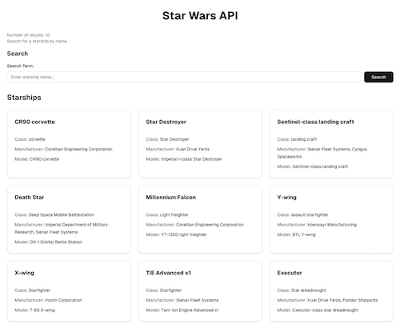

<h1>
  <span class="headline">vO Demo</span>
  <span class="subhead"></span>
</h1>


From the vO docs...

  > Turn your ideas into real web apps with v0.

  > v0 turns your ideas into real web apps, no coding required. Describe what you want with natural language, and v0's intelligent agent builds it for you using modern frontend tools. v0 can search the web, inspect sites, automatically fix errors, and integrate with external tools. By removing the technical barriers to web development, anyone can go from concept to working software in minutes.

- [vO](https://v0.app/)
- [What is vO?](https://v0.app/docs/introduction#engineers)

<br>

## Use vO to generate the Star Wars App React Frontend

To see v0 in action, paste the prompt below into the field on the [vO homepage](https://v0.app/) and observe what is generated. How does it compare to the app you built? 

<details>
<summary>Sample VO Prompt</summary>

```
You're a javascript react developer expert. Create a react application based on the info below.

You will create a fetch request to the "https://swapi.dev/api/starships/" endpoint to request data for the app.

In the list below, you'll find a brief description of the role of each component in your app:

- App: The root component that orchestrates the entire application.
- StarshipSearch: Allows users to submit a search form for the name of a starship.
- StarshipList: Displays a list of starships held in state.
- StarshipCard: A component used within StarshipList that displays information on a single starship.

Use the following user stories as a guide as you build each feature:

- As a user, I should see a list of starships when the site loads. This should be displayed as a card for each starship.
- As a user, I should see the name, starship_class, manufacturer, and model data for a starship in each card.- As a user, I should see a search bar above the list of starships. I should be able to enter a starship's name (or a portion of the name) into the search bar and submit my query. When the query is submitted, the input should be reset so I can easily enter my next query.
- As a user, when I submit a search, the starship results shown should update based on my query. My query should not be case sensitive and also return partial name matches.
- As a user, I should see some search metadata above the search form. This search data should include:
  - The number of results currently shown. This should always be displayed, even if I haven't conducted a search.
  - My last search query, if I have made one. If I have not conducted a search or the search results have been reset, the text "Search for a starship by name." should be shown instead.
- As a user, I should be able to reset the search by clicking a button labeled Show all starships. This button should only be shown if I have applied a search filter. This button should effectively clear my last search query.
```
</details>

<br>

Here's what vO generated for me...

